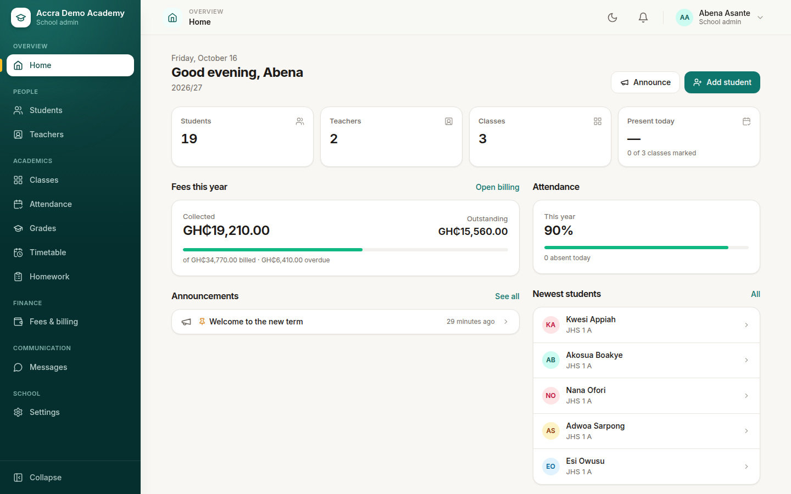
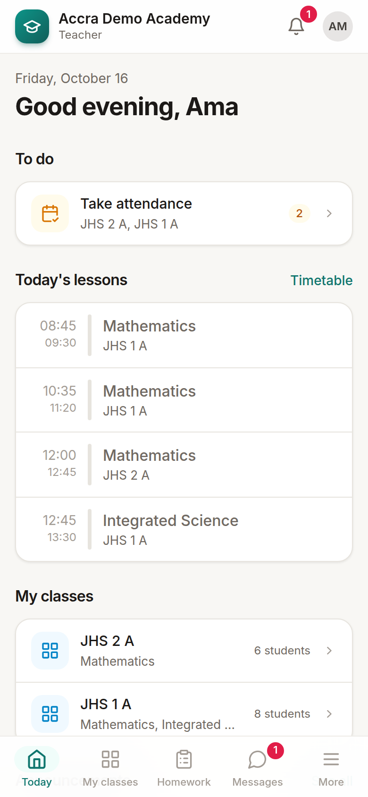
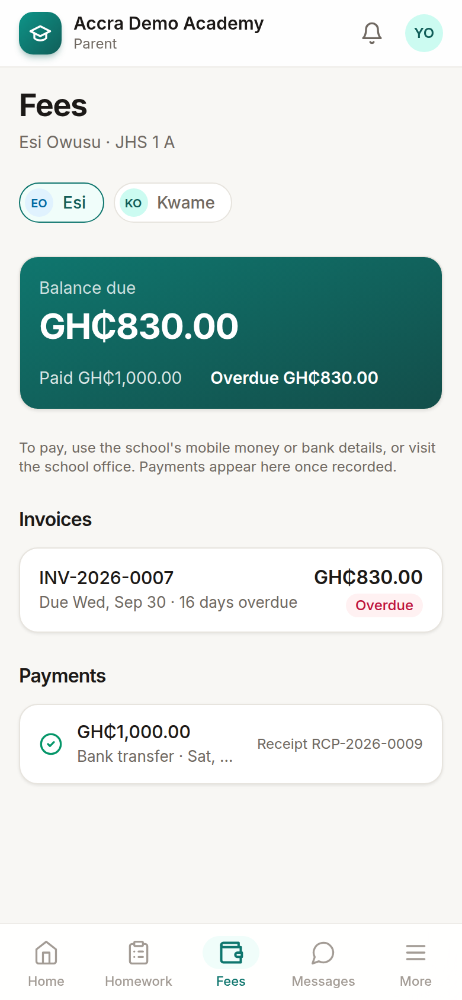
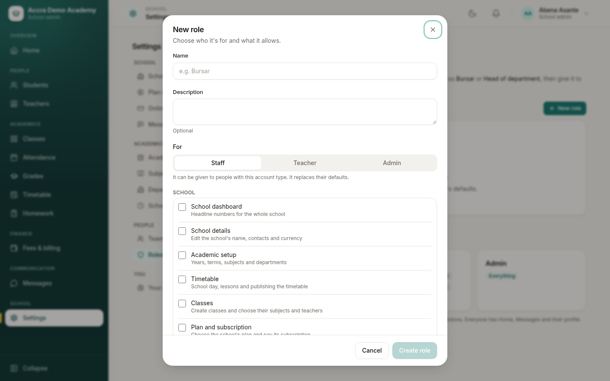
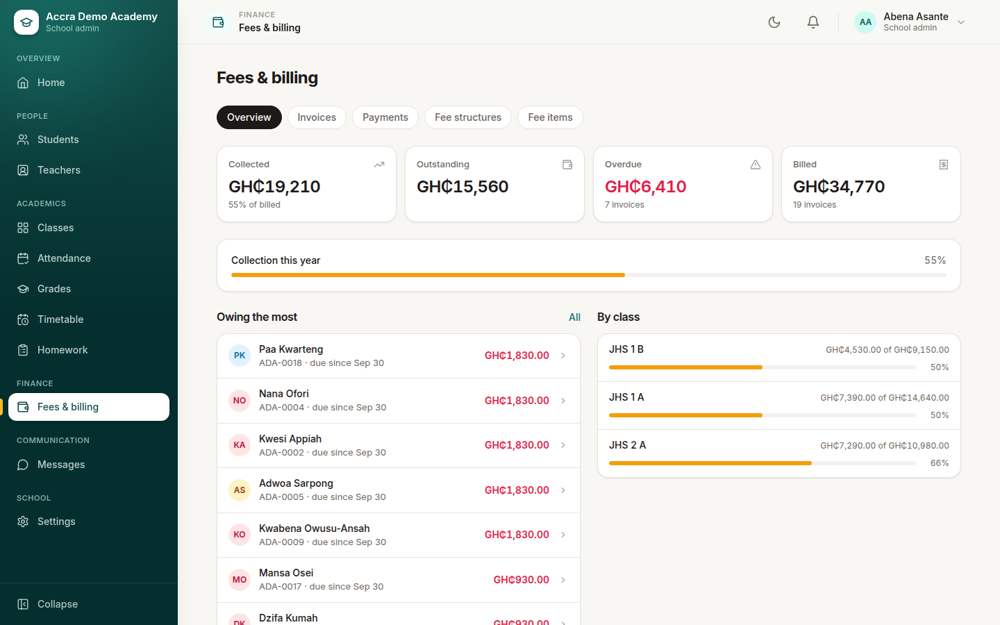
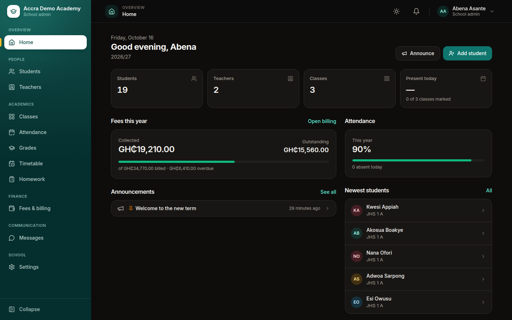

# School management SaaS

**One app that runs a whole school, on any phone.** Admissions and records, attendance, marks and report cards, timetables, homework, fees and messages, with a separate experience for administrators, teachers, staff, parents and students.

[**Live demo →**](https://school-app-nu-six.vercel.app) &nbsp;·&nbsp; React · TypeScript · Tailwind CSS · Node.js · PostgreSQL

> This repository is a product showcase. The source code is private (commercial); I'm happy to walk through it on a call.

  

  
  &nbsp;
  

## What it does

| Who | What they get |
|---|---|
| **School admins** | A dashboard of the school at a glance, students and staff, classes and subjects, the timetable, fee structures and invoices, and roles and permissions |
| **Teachers** | Today's lessons, registers in a few taps, gradebooks for the subjects they teach, homework to set and mark |
| **Parents and students** | Timetable, homework, attendance, report cards, fee balance, paying online by mobile money or card, and messages from school |
| **The bursar** | Fee items and structures, billing by class, recording payments with receipts, refunds with approval, arrears |

## Frontend engineering

- **Feels like a native app on phones:** a bottom tab bar, pushed screens with back navigation, bottom sheets, safe-area spacing and large tap targets. On wide screens it becomes a collapsible sidebar with a top navbar.
- **A small design system:** buttons, sheets, menus, responsive tables that turn into card lists on phones, form fields, empty and error states, all on CSS-variable design tokens with light and dark themes.
- **Permission-driven UI:** navigation, routes and every action button follow fine-grained permissions and custom roles (e.g. a "Bursar" sees fees and nothing else).
- **Complex journeys made simple:** spreadsheet imports with a downloadable template, a column guide and row-by-row validation; online checkout with confirmation on return; plan selection and billing.
- **Data layer:** React Query for server state, optimistic updates where safe, skeleton loading and retry states.
- **School-branded:** each school's sign-in page and emails carry its own name and logo.

  
  

## Under the hood

- **Multi-tenant:** every query is scoped to the school; cross-school access is tested automatically.
- **Payments:** Paystack and Moolre behind one provider interface. Each school's money settles to its own account, and webhooks are signed and idempotent.
- **Messaging:** SMS and WhatsApp through a delivery queue with retries; each school sends SMS under its own sender name.
- **Subscriptions:** plans, trials, student limits and renewals for the schools themselves.
- **Quality:** unit tests plus an end-to-end security suite of 190+ checks (tenant isolation, permissions, webhooks).

**Stack:** React 18, TypeScript, Vite, Tailwind CSS, React Query · Node.js, Express, Prisma, PostgreSQL (Neon) · Vercel
